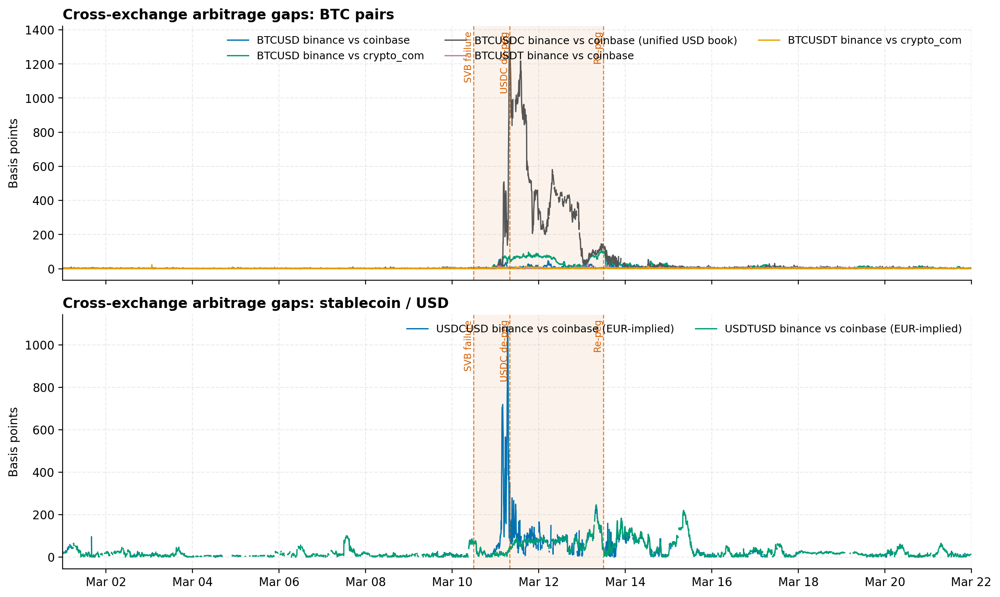
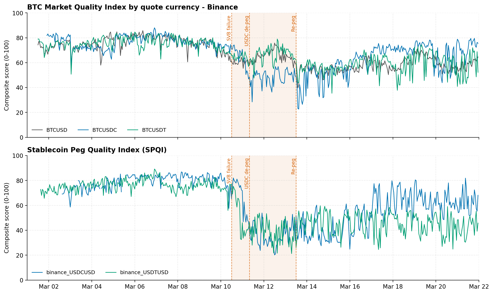
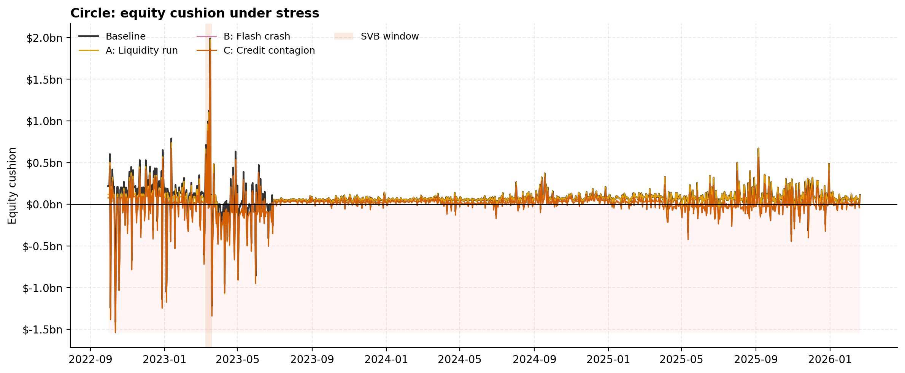
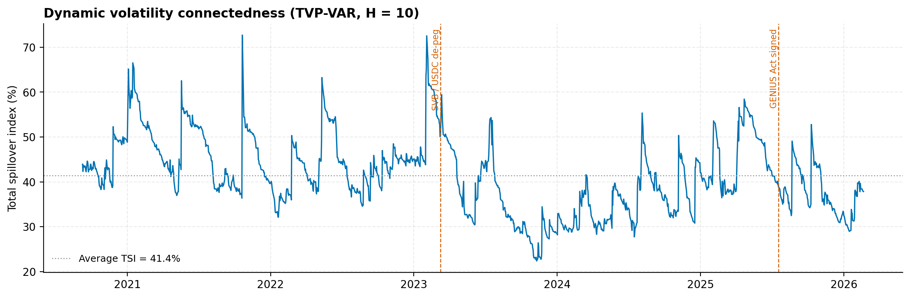

# Thin Cushions and False Security
### Stablecoin resilience under the GENIUS Act, using the 2023 SVB failure as a natural experiment

[](https://github.com/Khush-Paliwal/stablecoin-resilience-svb/actions/workflows/ci.yml)


*IAQF Student Competition 2026 · Team YieldCurveSurfers · UCLA Anderson MFE*

When Silicon Valley Bank failed on 10 March 2023, Circle disclosed that $3.3bn of USDC reserves were stuck there.
USDC fell to $0.87 within hours, while Tether's USDT (by conventional metrics the *riskier* coin) held its peg.
This repository asks **why**, and whether the GENIUS Act (signed July 2025), which mandates high-quality reserves
but no capital buffer, would have prevented it.

**Thesis.** Reserve *quality* is not enough. Circle met every asset standard the Act now requires and still broke
the buck; Tether did not and held. What separated them was **loss-absorbing equity**. A minimum equity-buffer
ratio, analogous to the Basel III leverage ratio, is the missing complement to the Act's reserve rules.

---

## Key results

All numbers are produced by `stablecoin-risk run all` and written to [`reports/RESULTS.md`](reports/RESULTS.md).

| Analysis | Result |
|---|---|
| **Peg deviation** (Binance.US, peak 10–13 Mar) | USDC median 207 bps off par (max 1,367 bps); USDT median 47 bps (max 165 bps) |
| **Cross-venue dislocation** | BTC/USDC gap Binance vs Coinbase up to **1,425 bps** (crisis median 110 bps); BTC/USDT crisis median ≤ 3 bps, BTC/USD 5–31 bps |
| **Market quality** (MQI, 0–100) | BTC/USDC 77 → 54 during the crisis vs 63 (BTC/USD) and 66 (BTC/USDT) |
| **Price impact** (Amihud, crisis ÷ pre-crisis) | USDC/USD ×11.9, BTC/USDC ×3.6; BTC/USD ×0.8, BTC/USDT ×0.6 |
| **Regime switching** | BTC/USDC basis enters the stress state 11 Mar 03:20 UTC (mean −290 bps); USDT re-prices to a persistent +30–50 bp premium |
| **Volatility connectedness** (TVP-VAR, 8 assets, 2020–2026) | Total spillover index **41.4%** (static VAR: 28.3%); USDT (+6.3) and USDC (+1.9) are **net transmitters** |
| **Stress test: liquidity run** (30% redemption, 2% fire-sale) | Circle's cushion negative on **14.9%** of days vs **3.1%** for Tether, even though Circle's liquid-asset coverage was higher (0.81 vs 0.37 on 10 Mar 2023) |
| **Stress test: market/credit shocks** | Tether fails B (35% of days) and C (90%), which is the risk the GENIUS Act's asset rules target |

<p align="center">
  
  
  
  
</p>

---

## What's in the box

```
stablecoin-resilience-svb/
├── src/stablecoin_risk/          # installable package (all analysis logic lives here)
│   ├── config.py                 # paths, event dates, regimes, every model parameter
│   ├── data/
│   │   ├── loaders.py            # 4 exchange schemas -> one canonical OHLCV frame; reserves; regression inputs
│   │   ├── cleaning.py           # causal gap-filling (LOCF / ETS / drop) with audit trail
│   │   ├── collectors.py         # Binance.US bulk+REST, Coinbase, Kraken clients with retry + source cascade
│   │   └── quality.py            # stablecoin peg-band audit with cross-exchange verification
│   ├── microstructure.py         # Amihud, Roll, Corwin-Schultz, Abdi-Ranaldo, Kyle-Obizhaeva, VPIN,
│   │                             # efficiency ratio, arbitrage gaps, MQI, order-flow-imbalance Kyle's lambda
│   ├── basis.py                  # cross-quote BTC basis + Markov-switching regimes
│   ├── spillover.py              # Parkinson vol, GFEVD (vectorised), static VAR & TVP-VAR connectedness
│   ├── regressions.py            # peg-deviation panel regressions (HAC / panel-HAC / Driscoll-Kraay)
│   ├── reserves.py               # attestation-based balance-sheet facts (Figs 4-5)
│   ├── stress_testing.py         # Basel III-style scenarios A/B/C
│   ├── event_study.py            # (exploratory) GENIUS Act intraday volatility event study
│   ├── volatility_models.py      # (exploratory) GARCH(1,1)-t and bivariate DCC(1,1)
│   ├── plotting.py               # one house style for every figure
│   ├── pipeline.py               # analysis steps -> reports/tables, reports/figures, RESULTS.md
│   └── cli.py                    # `stablecoin-risk run all`
├── notebooks/                    # executed narrative notebooks (thin layer over the package)
│   ├── 01_data_quality.ipynb
│   ├── 02_svb_liquidity_and_fragmentation.ipynb
│   ├── 03_order_flow_kyle_lambda.ipynb
│   ├── 04_volatility_spillovers.ipynb
│   ├── 05_peg_deviation_regressions.ipynb
│   ├── 06_reserves_and_stress_tests.ipynb
│   └── exploratory/              # work in progress: GENIUS Act event study, BTC GARCH/DCC
├── tests/                        # 38 tests: estimator unit tests, causality checks, paper-number regressions
├── data/                         # public data only - see data/README.md
├── reports/                      # generated tables (CSV + Markdown), figures, RESULTS.md; paper/ = submitted figures
└── docs/methodology.md           # equations, assumptions, and corrections to the competition code
```

## Quickstart

```bash
git clone https://github.com/Khush-Paliwal/stablecoin-resilience-svb.git
cd stablecoin-resilience-svb
python -m venv .venv && source .venv/bin/activate      # Windows: .venv\Scripts\activate
pip install -e ".[dev]"                                # add ,exploratory for GARCH/DCC (arch)

stablecoin-risk run all        # ~1 min: clean data -> every table and figure -> reports/RESULTS.md
pytest                         # 38 tests
```

Individual steps: `stablecoin-risk run clean liquidity basis kyle spillover regressions stress`.
Steps whose inputs are licensed (`kyle`: CoinAPI order books; `spillover`: Bloomberg) are **skipped with a message**
when the files are absent, so the public pipeline always completes.

## Data

| Dataset | Source | In repo? |
|---|---|---|
| 1-min OHLCV, 1–21 Mar 2023 (Binance.US, Coinbase, Crypto.com) | exchange public APIs | yes, `data/raw/` |
| EUR/USD 1-min (to imply Coinbase USDC/USD and USDT/USD) | HistData | yes |
| Daily BTC/ETH/USDC/USDT OHLCV, 2020–2026 | Binance.US → Coinbase → Kraken cascade (`collect-daily`) | yes |
| Tether and Circle reserve reconstructions and attestations | tether.to / circle.com transparency reports | yes, `data/reserves/` |
| Peg-deviation regression panel | exchange data + reconstructed balance sheets + VIX | yes, `data/regression/` |
| DXY, gold, S&P 500, KBW, VIX daily OHLC | Bloomberg | **no** (licensed) |
| Level-1 order books | CoinAPI | **no** (licensed) |
| Kraken 1-min OHLCV used in the submitted paper | Kraken | **no** (add to `data/raw/kraken/`, picked up automatically) |

Details and file formats: [`data/README.md`](data/README.md).

## Engineering notes

* **One canonical schema.** Every exchange file is normalised once (`loaders.standardize_ohlcv`), replacing
  four near-duplicate cleaning scripts and three copies of the loader.
* **No look-ahead.** Gap-filling uses only pre-gap data, rolling estimators are backward-looking, and the
  Abdi–Ranaldo term is lagged. Unit tests assert this by perturbing the future and checking the past is unchanged.
* **Reproducible.** Paper numbers (regression N = 2,460 and R² = 0.301; TVP-VAR TSI = 41.43%) are pinned in
  `tests/test_reproduction.py`. The TVP-VAR runs in ~5 s (vectorised GFEVD instead of nested Python loops).
* **Honest outputs.** Dead and mirrored feeds are detected and excluded, imputed bars are flagged and kept out of
  cross-venue comparisons, and regression tables report Driscoll–Kraay errors alongside the paper's Newey–West.

## Corrections relative to the competition code

Rebuilding the analysis as a tested package surfaced issues in the original notebooks. They are fixed here and
documented so results can be compared:

| Issue | Effect | Fix |
|---|---|---|
| Crypto.com BTC/USDC and USDT/USDC are dead feeds (zero volume, frozen price) | A "42% Binance vs Crypto.com BTC/USDC gap" in the draft narrative was an artifact | `is_active_market` filter |
| Coinbase BTC-USDC mirrors the unified BTC-USD book | Duplicated a market in every cross-section; basis identically 0 | `config.MIRRORED_MARKETS` |
| Corwin–Schultz spread omitted the `1 + e^α` denominator | Spread level ~2× too high (z-scored MQI essentially unchanged) | Paper formula |
| Abdi–Ranaldo took per-bar square roots and used t+1 data | Upward bias and one-bar look-ahead | Average, then square root; term lagged |
| Figure 1's arbitrage-gap frame was built in a deleted cell | Figure not reproducible | `pipeline.arbitrage_gap_panel` |
| Tether stress test summed the corporate-bond **duration** column into notional | Negligible ($180) but wrong | Explicit column mapping |
| Regime-switching cell reused a stale model object inside a loop | Every exchange printed the same regime means | One fit per series |
| GARCH on one-minute returns ×100 stalled at start values; DCC crashed on invalid parameters | Uninformative estimates | Basis-point scaling, Student-t errors, closed-form 2×2 DCC |
| Stress-test write-up said "Circle fails, Tether passes" | Both cushions dip below zero on 20 Mar 2023 in the noisy daily reconstruction | Report share of days insolvent (14.9% vs 3.1%) |

## Limitations

* Daily balance sheets interpolate quarterly attestations, so day-to-day equity is noisy; conclusions rest on
  frequencies over the sample, not single days.
* The SVB window has only ~8 trading days per exchange in the regression panel; stress interactions are not
  robust to Driscoll–Kraay errors.
* Bar-level microstructure proxies (Kyle's λ from candles, tick-rule VPIN) are coarse; the order-book λ is
  preferred where CoinAPI data exist.
* The exploratory GENIUS Act event study has overlapping event windows (House vote and signing 4 hours apart).

## Credits

Original research: team **YieldCurveSurfers** (UCLA Anderson MFE), IAQF Student Competition 2026.
Package refactor, testing and documentation: **Khush Paliwal**.
Key references are listed in [`docs/methodology.md`](docs/methodology.md).
